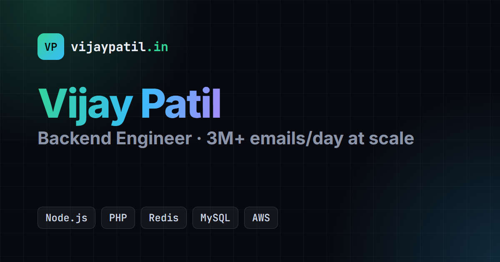

# Vijay Patil | Portfolio

[](https://www.vijaypatil.in)
[](https://github.com/Vijaypatil333/portfolio/actions/workflows/ci-cd.yml)

### 👉 **[www.vijaypatil.in](https://www.vijaypatil.in)**

[](https://www.vijaypatil.in)

Personal portfolio of **Vijay Patil**, a backend engineer building scalable, high-volume systems with Node.js, PHP, MySQL, Redis and AWS.

**On the site:** intro · work experience · projects (with architecture flows) · skills · interests · education & achievements · contact · [resume (PDF)](https://www.vijaypatil.in/Vijay_Patil_Resume.pdf)

## Tech stack

| Area | Tools |
|---|---|
| Frontend | React 18, Vite 4, plain CSS (dark/light theme, responsive) |
| CI/CD | GitHub Actions: build → verify → deploy |
| Hosting | Vercel (global CDN, automatic HTTPS) |
| Domain | `vijaypatil.in` (DNS on Hostinger) |
| SEO | Meta tags, Open Graph preview, JSON-LD `Person` schema, sitemap, robots.txt |

## How deployment works

```
push / PR ──► GitHub Actions ──► build & verify ──► deploy to Vercel ──► www.vijaypatil.in
                                  (fails? stops)     main → production
                                                     PR   → preview link on the PR
```

- Every push to `main` goes live automatically. Pull requests get their own preview URL.
- **Caching:** each deployment gets a fresh CDN cache, `index.html` is served with `max-age=0, must-revalidate`, and JS/CSS files have content-hashed names. No manual cache purge is needed after a deploy. If an old version appears, it's the browser (hard refresh with `Ctrl+Shift+R`) or a link-preview / search-engine cache.

Full setup guide: [DEPLOYMENT.md](DEPLOYMENT.md)

## Contact

[Website](https://www.vijaypatil.in) · [LinkedIn](https://www.linkedin.com/in/vijaypatil333/) · [GitHub](https://github.com/Vijaypatil333) · [Email](mailto:patilvijay98968@gmail.com)
